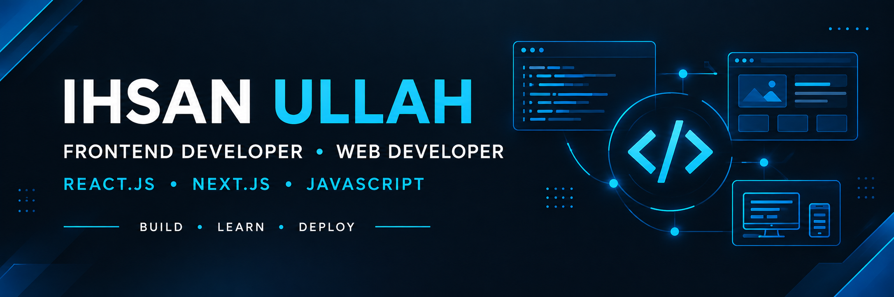

 

  

## TECH STACK & SKILLS

<table width="100%">
  <tr>
    <td width="33.33%" valign="top">
      <h3>Profile</h3>
      
<b>Frontend Developer</b> focused on building responsive and user-friendly web applications.

      

        Rawalpindi, Pakistan 
        BS Computer Science 
        Frontend Developer at SwisMax Solutions 
        Modern Web Technologies
      

    </td>
    <td width="33.33%" valign="top">
      <h3>Core Skills</h3>
      <ul>
        <li>HTML5 & CSS3</li>
        <li>JavaScript</li>
        <li>React.js</li>
        <li>Next.js</li>
        <li>Bootstrap & Tailwind CSS</li>
        <li>Responsive Web Design</li>
        <li>Git & GitHub</li>
      </ul>
      
<b>Workflow:</b> 
      Plan → Design → Code → Deploy

    </td>
    <td width="33.33%" valign="top">
      <h3>Backend Learning</h3>
      <ul>
        <li>Node.js</li>
        <li>Express.js</li>
      </ul>
      
Currently expanding my skills in backend development and the MERN Stack.

    </td>
  </tr>
</table>

  
  

---

## About Me

<table width="100%">
  <tr>
    <td width="65%" valign="top">
      
I'm a Frontend Developer focused on building responsive, user-friendly web applications using modern web technologies.

      <ul>
        <li>Modern UI Development</li>
        <li>React.js & Next.js</li>
        <li>Responsive Web Design</li>
        <li>Reusable Components</li>
        <li>Git & GitHub</li>
        <li>Node.js & Express.js (Currently Learning)</li>
      </ul>
      
I enjoy turning ideas into practical web experiences using modern frontend technologies.

      
<b>Current Direction:</b> Improving my frontend skills and learning backend development with Node.js and Express.js.

    </td>
    <td width="35%" align="center" valign="middle">
      
      
<b>Frontend Developer</b>

      
React.js · Next.js · JavaScript

    </td>
  </tr>
</table>

---

## 📊 GitHub Stats

  
  

---

## Featured Projects

- **Fast Reach Website** — Responsive business website.
- **Zad Academy Website** — Islamic educational website.
- **SwisMax Services Website** — Multiple services portfolio.

---

## Connect With Me

- LinkedIn: https://linkedin.com/in/ihsan-ullah-3a9528367
- GitHub: https://github.com/ihsandanish1000pp-dev

  <i>Thanks for visiting my GitHub profile!</i>

