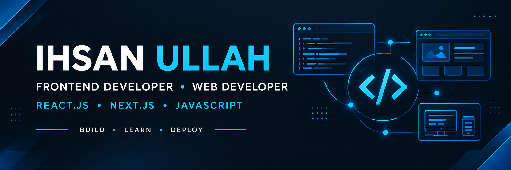

  

## 🚀 Tech Stack & Skills

<table>
  <tr>
    <td align="center" width="33%">
      <h3>🎨 Frontend</h3>
        
        
      
    </td>
    <td align="center" width="33%">
      <h3>⚛️ Frameworks</h3>
        
      
    </td>
    <td align="center" width="33%">
      <h3>🛠️ Developer Tools</h3>
        
      
    </td>
  </tr>
</table>

## 🚀 My Skills

<table>
  <tr>
    <td align="center" width="33%">
      <h3>🎨 Frontend</h3>
      
HTML5

      
CSS3

      
JavaScript

      
Bootstrap

      
Tailwind CSS

    </td>
    <td align="center" width="33%">
      <h3>⚛️ Frameworks</h3>
      
React.js

      
Next.js

    </td>
    <td align="center" width="33%">
      <h3>🛠️ Tools</h3>
      
Git

      
GitHub

      
VS Code

    </td>
  </tr>
</table>
